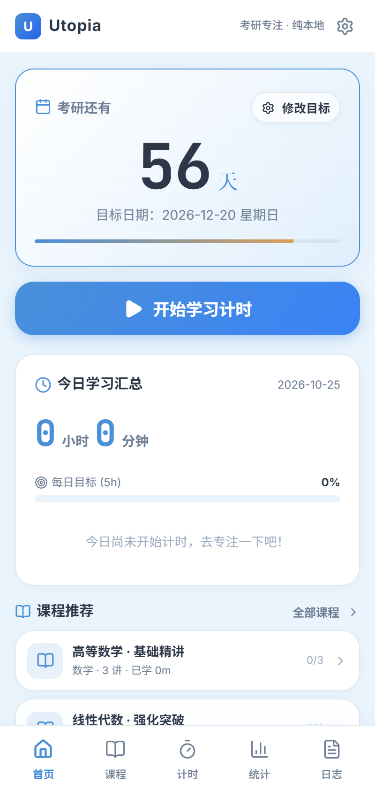
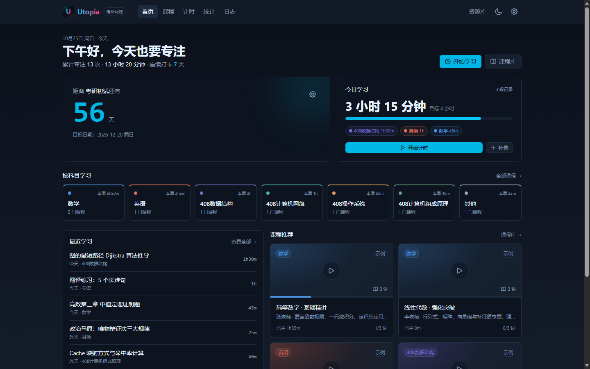
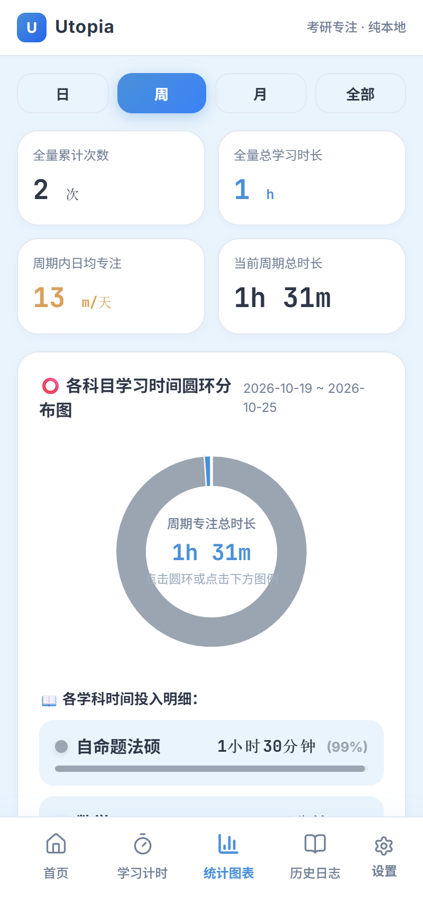
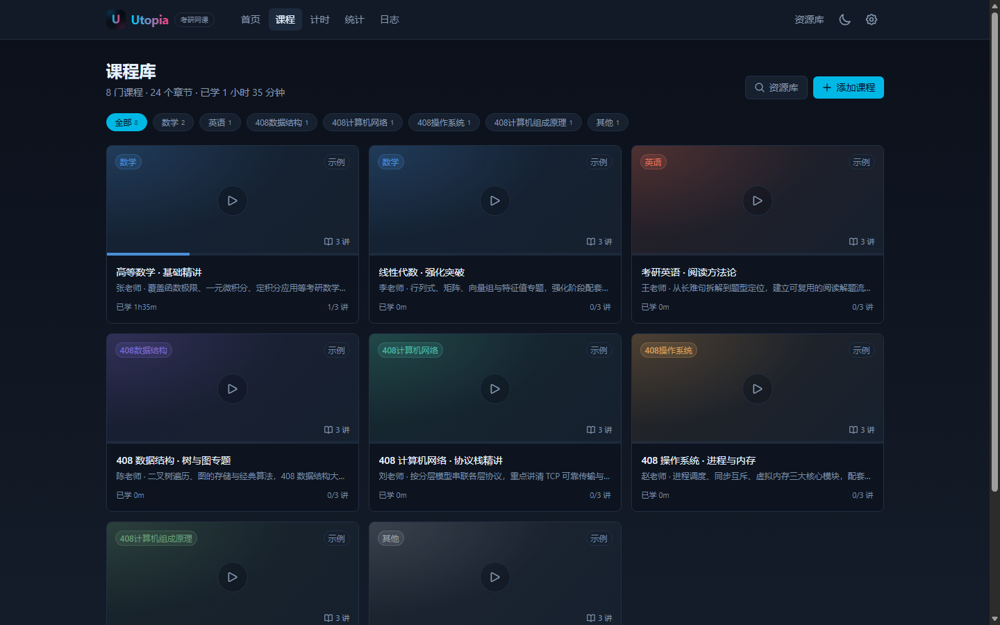

# Utopia

> 考研备考一体化工具：**移动端 App + Web 网课平台 + 安装包分发服务**。纯本地数据、无账号、无广告。

## 项目介绍

2026年10月25日我在B站看网课时苦于每次都要自己手动调进度，便想着能不能自己做一个播放器具有记忆功能，于是乌托邦个人考研网课平台诞生了。

本平台基于libretv和研时记两个开源项目，同时具备视频播放和学习计时功能，本项目禁止商用，视频源需要自己获取，祝愿每个使用该项目的考研人能够成功上岸。

如果你没有能力支持正版，希望你在获取盗版资源的时候不要跳脸那些支持正版的同学，如果你有能力支持正版但觉得本项目更便利，请在支持正版后采用本项目。

再次感谢每一个开源者对社区的贡献，如果觉得本项目还有可优化的地方，请向我的个人邮件qz3589@qq.com发送邮件。

愿世界更加美好，这里是乌托邦，感谢您的支持与理解。

## 三端结构

| 目录 | 说明 | 技术 |
|---|---|---|
| [app](app/) | Android / 移动端 App：倒计时、计时、统计、日志、补录、备份 | React 19 + Vite + Capacitor 8 |
| [video](video/) | Web 网课平台：课程库、播放即计时、倒计时、统计、日志、资源库 | Next.js 15 + TypeScript + Tailwind |
| [backend](backend/) | 安装包分发 + 移动端 Web 在线版托管 | Node 内置 http（零依赖） |
| [docs](docs/) | 开发文档与产品规格 | Markdown |
| [screenshots](screenshots/) | 移动端截图 | PNG |

## 界面预览

| 移动端首页 | Web 学习台 |
|---|---|
|  |  |

| 移动端统计 | Web 课程库 |
|---|---|
|  |  |

| 移动端课程库 | 移动端播放计时 |
|---|---|
|  |  |

## 快速开始（Windows）

双击根目录 **`启动.bat`**，按菜单选择：

1. **Web 平台**：Next.js 网课平台，<http://localhost:8080>，访问密码见 `video/.env`（默认 `utopia2026`）。
2. **Web 开发模式**：保存代码即热更新。
3. **移动端 Web + APK 下载**：<http://localhost:8081>。
4. **打开文档目录**。

也可以直接进入子目录分别启动：

```bash
# Web 平台
cd video && npm install && npm run dev

# 移动端开发
cd app && npm install && npm run dev

# 分发服务
cd backend && node server.js
```

## 功能

### 移动端

课程库（按科目组织、章节 m3u8 / mp4 播放、播放即计时、章节进度），倒计时、正计时 / 番茄钟、科目管理、圆环统计、每日趋势、打卡历、历史日志编辑删除、手动补录、JSON 备份导入导出、深色模式。

### Web 网课平台

课程库按 7 个考研科目组织，章节支持 m3u8 / mp4 直链；**播放即计时**，离开页面自动保存；另有自由计时、日/周/月统计、学习日志、考试倒计时、资源库聚合搜索与课程进度。

### 分发服务

APK 下载页、二维码、HTTPS 部署说明、版本登记脚本。

## 数据与兼容

- 移动端本地存储键保留 `yanshiji_*` 前缀；Web 端迁移到 `utopia:*` 并自动读取旧的 `yst:*` 数据。
- 两端导出的备份 `app` 字段为 `Utopia`，导入同时兼容旧版「研时记」备份。
- Android `applicationId` 保留 `com.yanshiji.app`，改名为 Utopia 后仍可覆盖升级旧安装。
- 数据全部保存在浏览器 / 设备本地，不上传服务器。

## 文档

- [Utopia 开发文档](docs/Utopia-开发文档.md)（含数据模型、统计口径、边界用例）
- [Web 端说明](video/README.md)
- [移动端说明](app/README.md)
- [分发与打包](backend/README.md)

## 构建

```bash
# Web 生产构建
cd video && npm run build && npm start

# 移动端 Web 在线版（输出到 backend/public/web）
cd app && npm run build:web

# 移动端 Capacitor 资源
cd app && npm run build:app && npx cap sync android
```

APK 构建、签名与发布见 [backend/README.md](backend/README.md)。

## 贡献者

- **Utopia 作者**：[jiangrenbielang](https://github.com/jiangrenbielang)
- **LibreTV 创作者**：[bestZwei](https://github.com/bestZwei)
- **LibreTV 维护组织**：[LibreSpark](https://github.com/LibreSpark)

感谢 [LibreTV](https://github.com/LibreSpark/LibreTV) 及其全体贡献者为 Web 端播放与聚合能力打下的基础。完整名单见 [CONTRIBUTORS.md](CONTRIBUTORS.md)。

## License

移动端与分发服务沿用根目录 [LICENSE](LICENSE)；`video/` 为 LibreTV 衍生项目，遵循 AGPL-3.0-or-later（见 [video/LICENSE](video/LICENSE)）。
