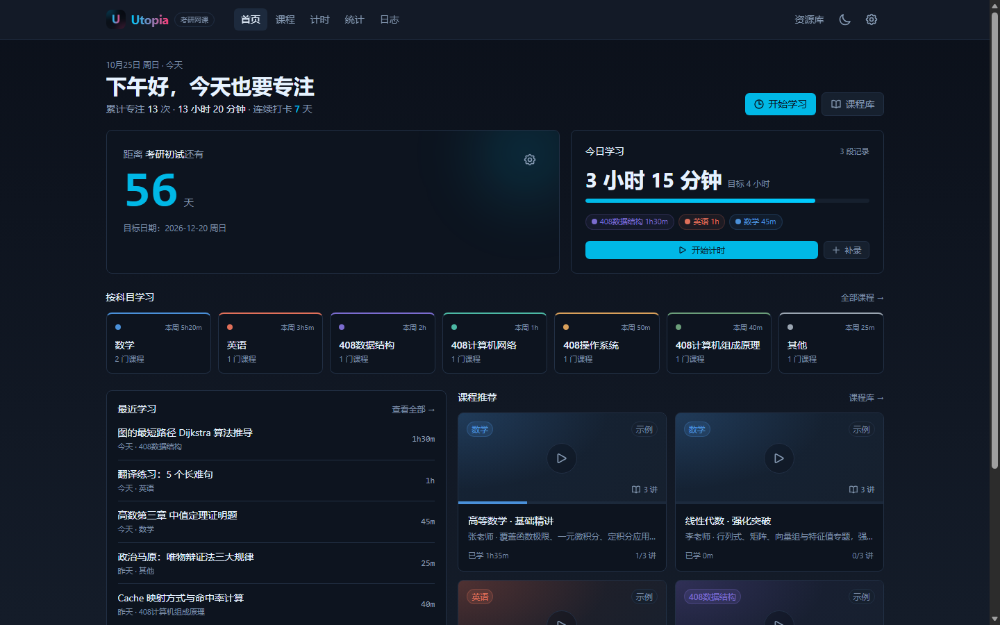
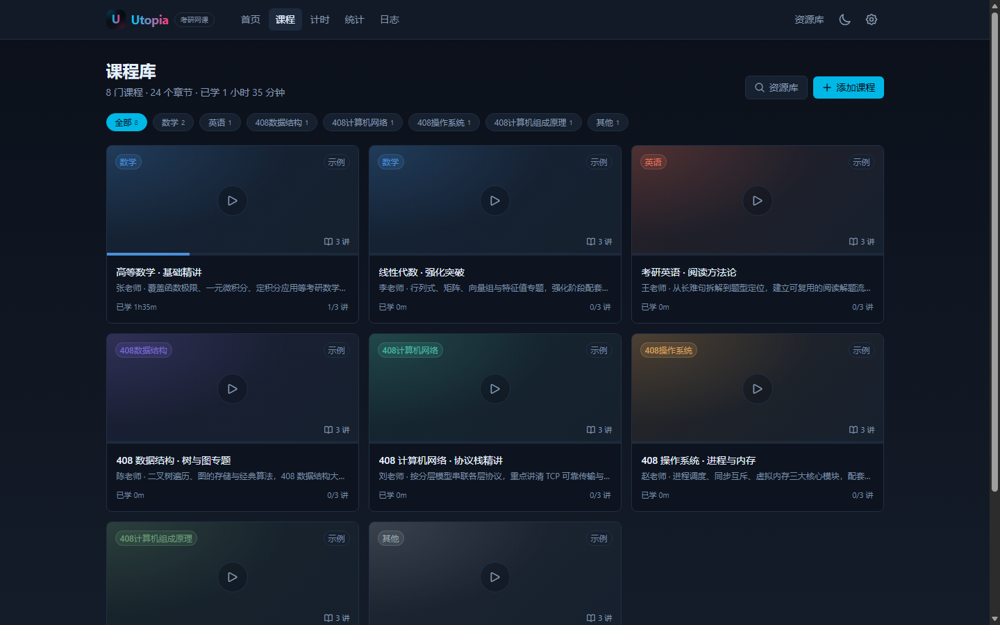
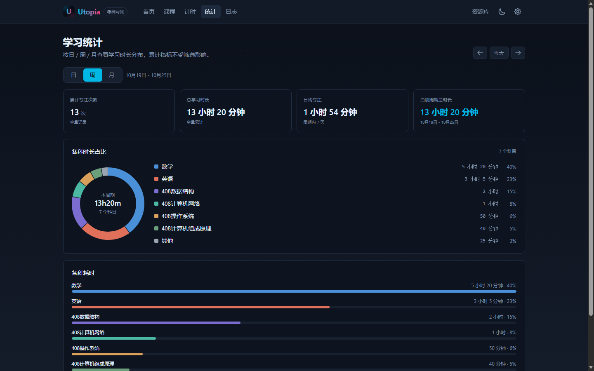
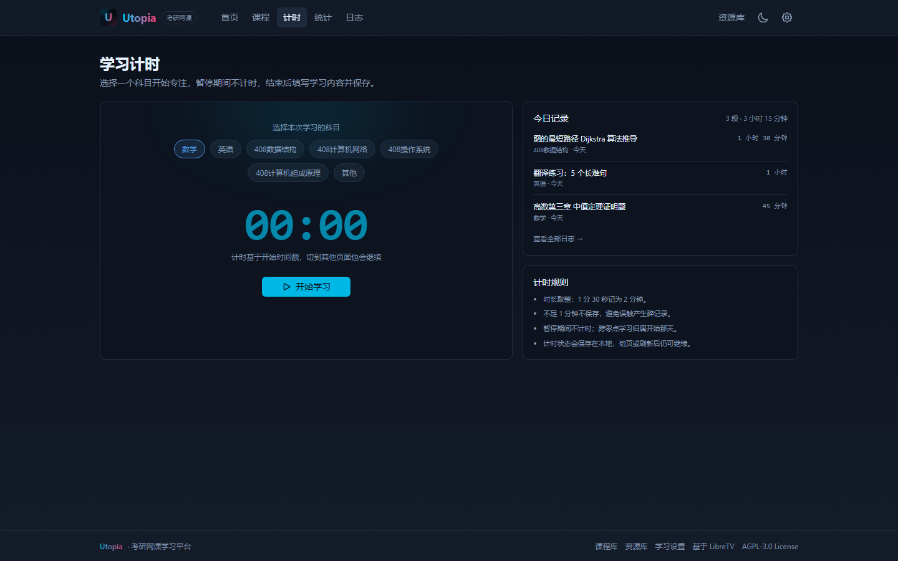

# Utopia · Web 网课平台

> Utopia 的 Web 端（Next.js）：按科目看网课，自动记录每一分钟学习时长。
> 桌面客户端见 [../desktop](../desktop)，统一入口见根目录 [README](../README.md)。

基于 [LibreTV](https://github.com/LibreSpark/LibreTV) 二次开发的考研网课平台：**按科目看网课，自动记录每一分钟学习时长**。播放内核沿用 LibreTV，**数据源改为 TVBox「配置地址」驱动**（一份接口 JSON 即可带出点播站点、直播源、解析线路与壁纸），界面已从 LibreTV 的深蓝黑霓虹风改为 **TVBox 风格**（中性深色 + 海报网格 + 顶部分类 tab），并新增倒计时、学习计时、统计图表、学习日志与课程库。

> LibreTV 原有的「Web 端配置」（访问密码、`DEFAULT_*` 环境变量、Docker 配置项）已删除：客户端不再需要访问密码，数据源统一由 TVBox 配置地址提供。

> 数据全部保存在浏览器本地（localStorage），无账号、无云同步；可在「学习设置」导出 JSON 备份。
> 课程视频与资源库内容来自你自行配置的第三方地址，请确保拥有相应学习权限。

## 界面预览

> ⚠️ 下面几张截图是**改造前**的界面（原 LibreTV 深蓝黑霓虹风），仅用于说明页面结构与功能布局；
> 当前界面已改为 TVBox 风格的中性深色主题 + 海报网格 + 顶部横向分类 tab，截图待重新生成。

| 学习台 | 课程库 |
| --- | --- |
|  |  |

| 统计（周） | 学习计时 |
| --- | --- |
|  |  |

---

## 功能

### 学习闭环

- **考试倒计时**：目标日期可配置，默认当年 12 月 20 日；过期自动切换「已考完」文案。
- **网课播放即计时**：直链视频按真实播放进度累计（暂停、快进不计）；B 站 iframe 按页面可见停留时长累计，可手动暂停。满 1 分钟可结束并填写学习内容，离开页面自动保存。
- **自由计时**：选科目开始 / 暂停 / 继续 / 结束，状态跨页保持；刷新后按心跳恢复，离线时段不计入。
- **今日汇总**：今日总时长、各科耗时、每日目标进度。
- **统计**：日 / 周 / 月（自然周、自然月）切换，累计次数、总时长、日均时长、周期时长、各科占比环形图与明细。
- **学习日志**：按日期倒序分页（20 条/页），日期 + 科目筛选，编辑、删除（可撤销）、手动补录。
- **课程库**：按 7 个考研科目组织课程；新建 / 编辑课程，章节支持 m3u8 / mp4 直链或 B 站站外播放器 iframe，记录章节学习进度。
- **资源库**：多源聚合搜索，源来自你填写的 **TVBox 配置地址**（详见下文「数据源：TVBox 配置地址」），用来检索第三方点播源中的网课视频。
- **备份恢复**：导出 / 导入「Utopia」JSON（合并按记录 ID 去重，或覆盖导入），同时备份课程库。

### 科目与配色（开发文档第九节）

数学 · 英语 · 408数据结构 · 408计算机网络 · 408操作系统 · 408计算机组成原理 · 其他。
科目固定配色贯穿课程卡片、统计饼图与日志徽标。

### 计时口径

| 规则 | 说明 |
| --- | --- |
| 取整 | `ceil(秒 / 60)`，1 分 30 秒记为 2 分钟 |
| 最短时长 | 不足 1 分钟不保存 |
| 暂停 | 暂停期间不计时，网课暂停同样不计 |
| 跨零点 | 记录归属计时开始那天 |
| 日均 | 周期总时长 ÷ 周期内已过天数 |
| 累计 | 全量记录，不受筛选影响 |

---

## 技术栈

- Next.js 15（App Router）+ React 19 + TypeScript + Tailwind CSS
- 播放器：ArtPlayer + hls.js（沿用 LibreTV 播放内核，含广告过滤、跨源换源、下载等能力）
- 数据源：**TVBox 配置（接口）JSON** —— `src/lib/tvbox-config.ts` 解析完整配置（`sites`/`lives`/`parses`/`flags`/`wallpaper`），`src/lib/tvbox-parser.ts` 负责「哪些条目能直接导入本站」的裁剪与跳过统计，`src/lib/tvbox-live.ts` 按**内容嗅探**解析直播播放列表（M3U / TVBox txt）
- 状态：学习数据用 `useSyncExternalStore` + localStorage；源与配置用 Zustand / IndexedDB
- 图表：纯 SVG 环形图，无额外图表依赖

## 快速开始

```bash
# 1. 安装依赖（若 pnpm 可用也可用 pnpm）
npm install

# 2. 开发
npm run dev        # http://localhost:8080

# 3. 生产
npm run build
npm start          # 默认 8080
```

可选环境变量（代理超时与重试、60s 榜单实例地址等）见 `.env.example`，不配置也能直接运行。

### Windows 一键启动

双击 `start-utopia-web.bat` 即可：自动安装依赖（首次）、构建（首次或检测到源码更新时）并启动服务，随后打开 <http://localhost:8080>。

- 修改代码后建议双击 `start-utopia-web-dev.bat`，保存即热更新；正式启动脚本检测到源码比构建新时也会自动重新构建（多等约 1 分钟）。
- 服务在单独的「Utopia Web Server」窗口运行，关闭该窗口即停止服务。

### Docker

```bash
docker compose up -d --build
```

镜像在本仓库构建（`utopia-web:latest`），不依赖上游 LibreTV 镜像；可选环境变量见 `docker-compose.yml` 内的注释（内网 IPTV 放行、代理超时、榜单实例地址等）。

---

## 课程从哪里来？

有三条路径，可混用：

1. **课程库 → 添加课程**：为每个章节填入可直链播放的 m3u8 / mp4 地址，或直接粘贴 B 站站外播放器 iframe（见下）。项目内置 8 门示例课程，章节使用公开测试流（mux / Apple），仅用于演示「播放即计时」；请替换为你自己的网课直链。
2. **TVBox 配置地址**（推荐）：在「学习设置 → TVBox 配置地址」填入一份 TVBox 接口地址，即可一次性带出点播站点与直播源，回到资源库搜索网课关键词，播放时同样自动计时。详见下节。
3. **手动补录 / 自由计时**：线下刷题、背书时用，记录同样进入统计与日志。

> 直链需要允许浏览器直接访问（HLS 需 CORS）。部分网课平台的视频带鉴权或防盗链，无法直接播放，请使用自己拥有权限的地址。

## 数据源：TVBox 配置地址

一份 TVBox 接口 JSON 就是本客户端的数据入口。填写后客户端会拉取、解析并落地为本地源，可随时一键刷新。

> 完整的兼容性说明（哪些能用、哪些会被跳过与原因、实测样本、已知缺口）单独成文：
> [TVBox 配置兼容性说明](docs/tvbox-compatibility.md)。字段语义的逐条考证见
> [TVBox 配置规范](docs/tvbox-config-and-ui-spec.md)。
>
> **一句话结论**：站点数量多不等于能用——社区配置里 Spider 类站点往往占绝大多数，而它需要
> Android TVBOX 客户端才能运行；纯 JS/Electron 客户端对此无能为力。导入后设置面板会给出
> 站点形态统计与跳过原因，不会让你以为「解析失败了」。

**能直接使用的条目**

| 配置字段 | 说明 |
| --- | --- |
| `sites[]` 中 `type:1` | JSON 采集站（Apple CMS 协议），可直接搜索与播放。注意这类源的接口路径常常不是标准的 `api.php/provide/vod`，本项目按 `type` 判定，不依赖路径特征 |
| `lives[]` 中的普通播放列表 | `type:0` 或未声明类型的 `url`。**按内容嗅探**格式（M3U 或 TVBox txt 频道列表），因此 `.txt` 后缀也可能是合法 M3U，不会被误拒 |
| `wallpaper` | 作为界面背景，加载失败静默忽略（真实配置里常是不带图片后缀的接口地址） |

**已支持使用**

| 配置字段 | 说明 |
| --- | --- |
| `parses[]` 中**可请求**的线路 | 播放页会出现「解析线路」按钮：点一下用该线路把当前地址换成真实地址，成功后可「恢复原地址」。返回 HTML 播放页的线路会明确提示「本客户端无法运行它」（需要在浏览器里执行脚本嗅探），不当成解析失败 |
| `flags` | 已识别的解析平台/线路白名单（`youku`/`qq`/`iqiyi`…），在设置面板与解析线路提示里展示。**它不是首页推荐分组** |
| `wallpaper` | 作为界面背景，加载失败静默忽略 |

**会被跳过、并在导入结果里说明原因的条目**

| 情形 | 原因 |
| --- | --- |
| `type:3` / `api: csp_xxx` / `jar`、`.js`、`.py` | Spider 类站点依赖 TVBOX 引擎（Android dex / QuickJS），纯 JS 客户端无法运行。**真实配置里这类往往占绝大多数**，例如 `jinenge/tvbox` 与常见 `top98.json` 全是 Spider 站点 |
| `type:0` 的 XML 接口 | 本项目只解析 Apple CMS 的 JSON 输出，不解析 `at/xml` 通道 |
| `lives[]` 的单仓 JSON（`group` + `channels`） | 需要 TVBOX 的聚合逻辑，未实现 |
| `parses[]` 中 `url` 为 `Parallel` / `Sequence` / `Web` / `Demo` | 这些是 TVBOX **客户端内置**的聚合解析器，不是可请求地址（已在数据层标记为 `builtin`，不会出现在解析线路列表里） |

**其它已处理的配置细节**

- 配置里带 `//` 注释、尾随逗号、字符串内裸控制字符都能解析（对齐 TVBOX 客户端 fastjson 的宽容度）。
- 相对路径（如 `./lib/iptv.m3u`、`./jar/x.jar`）相对**配置地址**解析，而不是相对本站页面。
- `spider` 形如 `./lib/x.jar;md5;…`，`;md5;` 后缀会被正确拆分；本站不运行 jar，只用于提示。
- `flags` 是**解析平台白名单**（`youku`/`qq`/`iqiyi`…），不是首页推荐分组；`sites[].categories` 在真实配置里几乎不出现，因此首页分类不由它驱动。

### 添加 B 站嵌入视频

B 站「嵌入代码」是 iframe，不是 m3u8 / mp4 直链，因此不能交给 ArtPlayer/hls.js。课程编辑已支持直接粘贴整段代码：

1. 打开 B 站视频 → 分享 → 嵌入代码，复制整段 `<iframe ...></iframe>`
2. 课程库 → 添加/编辑课程 → 章节的「视频地址」中粘贴整段代码
3. 保存后点击「播放」，会用 B 站站外播放器 iframe 打开

只接受 `player.bilibili.com/player.html` 地址，保存时会自动从 iframe 中提取 `src`，其它 HTML 不会写入数据。

> B 站 iframe 是跨域页面，无法读取播放/暂停状态，因此按「页面可见停留时长」计时：切后台不计，可点「暂停计时」；这与直链视频的「按真实播放进度计时」略有不同。若视频被 UP 主/版权方限制站外播放，页面会显示 B 站提示，请改用自己拥有权限的直链。

### 百度网盘 / 其他云盘

百度网盘没有公开的站外 iframe 播放器，`pan.baidu.com/s/...` 分享页需要登录，下载 `dlink` 需要 Cookie / 特定 User-Agent 且会过期，**不能直接粘贴到课程章节**。

推荐用 [AList](https://github.com/AlistGo/alist) / [OpenList](https://github.com/OpenListTeam/OpenList) 做一层转接：

1. 在电脑或 NAS 上部署 AList / OpenList，添加你的网盘存储并完成授权
2. **把「所有直链强制签名」关掉**（设置项 `sign_all=false`）。这一条是实测踩出来的：
   - 开着时 `/d/路径` 一律 **401**，必须用网页里复制的签名地址 `/p/路径?sign=…`；
   - 而签名是**按路径**的，清单里的相对分片（`seg0.ts`）拿不到签名 → HLS 必然播不出来；
   - 关掉后 `/d/路径` 直接可读，相对分片也能正常取回。
3. 在 AList 中找到视频文件，复制直链（`http://内网IP:5244/d/...`）
4. 课程库 → 添加/编辑课程 → 章节「视频地址」粘贴该直链
5. 手机端使用同一局域网时，把 `127.0.0.1` 换成电脑的局域网 IP；AList 需要保持运行

> ⚠️ `sign_all=false` 意味着**任何能访问该端口的人都能下载你的文件**。若 AList 监听 `0.0.0.0`，同局域网的人都能读。建议把 AList 的监听地址改成 `127.0.0.1`（只本机可用），或只在临时观看时关闭签名。

注意事项：

- **AList 通常在本机或局域网**（`http://127.0.0.1:5244`、`http://192.168.x.x:5244`），而媒体代理默认会拒绝内网地址以防 SSRF —— 不开开关的话，粘进来的直链与它的 M3U8 分片都会被拦下，表现为「播不出来」。放行方式：
  - **桌面客户端**：默认已放行（数据层只监听 `127.0.0.1`，不对局域网暴露），可在「设置」里关闭；
  - **Web / Docker 部署**：设 `ALLOW_PRIVATE_UPSTREAM=1`（见 `.env.example` 与 `docker-compose.yml` 注释）。⚠️ 只在服务不对外暴露时打开，公网部署请保持关闭，否则代理会成为内网探测跳板。
  - 这个开关与「自建 IPTV」的 `LIVE_ALLOW_PRIVATE` **各自独立、互不影响**。
- **HLS 清单的识别不看 content-type**：AList / OpenList 把 `.m3u8` 以 `application/octet-stream` 返回，且直链带 `?sign=` 查询串，因此清单判定改用「URL 路径（剥掉查询串）以 `.m3u8`/`.m3u` 结尾」。清单会被重写为同源代理地址，分片与 Range 一并经本站转发（已用真实 OpenList 验证：清单 200、分片 200、Range 206）。
- 浏览器通常只支持 mp4 / HLS；`.mkv`、`.avi` 等需要先用 ffmpeg 转成 mp4 或 HLS
- 百度网盘直链可能限速、过期或 403；AList 代理也不保证所有文件都能播放
- 网盘视频需要你有权访问；不要把账号 Cookie 写进课程数据或公开仓库
- 如果视频在百度智能云 BOS 等对象存储里，且是公开读的 `https://...mp4` 直链，可以直接粘贴（同样需要支持 Range / CORS）

> 纯前端无法稳定直连百度网盘：百度开放平台的 `dlink` 需要服务端带 User-Agent 请求并处理过期，分享链接还需要登录态。当前 Utopia 是本地优先架构，不保存网盘账号；需要原生网盘接入时，应单独增加后端代理与 OAuth，而不是把分享链接直接填进播放器。

---

## 目录结构（新增部分）

```
src/lib/study/
  types.ts        # 数据模型、科目与固定配色、备份格式
  date.ts         # 本地日期工具（跨零点、自然周/月）
  stats.ts        # 日/周/月口径、聚合、连续打卡、课程进度
  store.ts        # localStorage 数据层：记录 / 配置 / 课程库 / 计时会话 / 备份
  seeds.ts        # 内置示例课程
  format.ts       # 时长与日期展示
src/components/study/
  page-shell.tsx  # 页面骨架（顶部导航 + 移动端底部导航）
  countdown-card.tsx
  timer-bar.tsx   # 全局计时迷你条
  save-dialog.tsx # 结束学习保存弹窗
  record-dialog.tsx # 补录 / 编辑记录
  course-card.tsx / course-dialog.tsx
  donut.tsx / subject-badge.tsx
src/app/
  page.tsx        # 学习台首页
  courses/        # 课程库与课程详情
  timer/          # 学习计时
  stats/          # 统计
  logs/           # 学习日志
  settings/       # 学习设置（目标、备份、清空、数据源）
  src/lib/
  tvbox-config.ts   # TVBox 配置完整数据层：sites/lives/parses/flags/wallpaper，宽容解析
  tvbox-parser.ts   # 「哪些条目能直接导入本站」的裁剪、去重与跳过统计
  tvbox-live.ts     # 直播播放列表按内容嗅探（M3U / TVBox txt）
  cms-parser.ts     # Apple CMS 协议（搜索 / 详情 / 播放地址）
  proxy-handlers.ts # 通用代理与直播长连接代理（框架无关，返回标准 Response）
  ssrf.ts           # 代理准入的唯一防线（字面量 + DNS + 逐跳重定向）
src/app/
  page.tsx        # 学习台首页
  courses/        # 课程库与课程详情
  timer/          # 学习计时
  stats/          # 统计
  logs/           # 学习日志
  settings/       # 学习设置（目标、备份、清空、TVBox 配置地址）
  resources/      # 资源库（多源聚合搜索）
  watch/          # 播放页（网课计时条与自动保存）
```

## 数据与备份

- 学习记录：`localStorage['utopia:records:v1']`
- 配置：`localStorage['utopia:config:v1']`（`examTargetDate`、`dailyTargetMin`）
- 课程库：`localStorage['utopia:courses:v1']`
- 计时会话：`localStorage['utopia:timer:v1']`（每 10s 心跳）
- 数据源、订阅与 TVBox 配置缓存：`localStorage['libretv-settings']`（Zustand 持久化快照，含 `customAPIs` / `subscriptions` / `tvboxByUrl`）

> 改名前使用 `yst:*` 键名的旧数据会在首次读取时自动迁移，升级不会丢失记录。

导出 JSON 与开发文档第七节一致（`app` / `formatVersion` / `config` / `records`），并扩展了可选的 `courses`、`courseId`、`lessonId` 字段；`app` 字段为 `Utopia`，同时兼容导入旧的 `研时记` 备份。

## 开发校验

```bash
npm run typecheck
npm run lint
npm run build
```

## 与 LibreTV 的关系

本项目的**播放内核、聚合搜索、代理与安全策略**来自 LibreTV（AGPL-3.0-or-later），这部分能力保留并继续使用；学习台、课程库、计时、统计、日志、备份与 **TVBox 配置驱动层**为本项目原创。

与原版的差异：

- **数据源入口改为 TVBox 配置地址**：LibreTV 的源列表订阅（LibreTV-SourceList JSON）仍兼容，但推荐用一份 TVBox 接口 JSON 统一下发点播站点、直播源、解析线路与壁纸。
- **删除了 LibreTV 的 Web 端配置**：访问密码门禁（`PASSWORD` / 会话 cookie / 登录弹窗）、`DEFAULT_SOURCES` / `DEFAULT_LIVE_SOURCES` / `DEFAULT_SUBSCRIPTIONS` / `DEFAULT_RECOMMEND_SOURCE` / `DEFAULT_IMAGE_MODE` 等部署期环境变量注入，以及 Docker/脚本里的默认密码生成逻辑，均已移除。
- **视觉语言改为 TVBox 风格**：中性深色底 + 海报网格 + 顶部横向分类 tab，去掉了 LibreTV 的深蓝黑霓虹配色与品牌渐变字。
- **持续保留的安全策略**：`/api/proxy` 与 `/api/live/stream` 的 SSRF 校验（字面量 + DNS + 逐跳重定向复检）现在是代理路由的**唯一**准入门槛——密码门禁移除后，它不能一并删掉；若部署在公网，请在反向代理层（Caddy `basicauth` / Cloudflare Access）或网络层限制访问。

## License

AGPL-3.0-or-later，与上游 LibreTV 一致。
