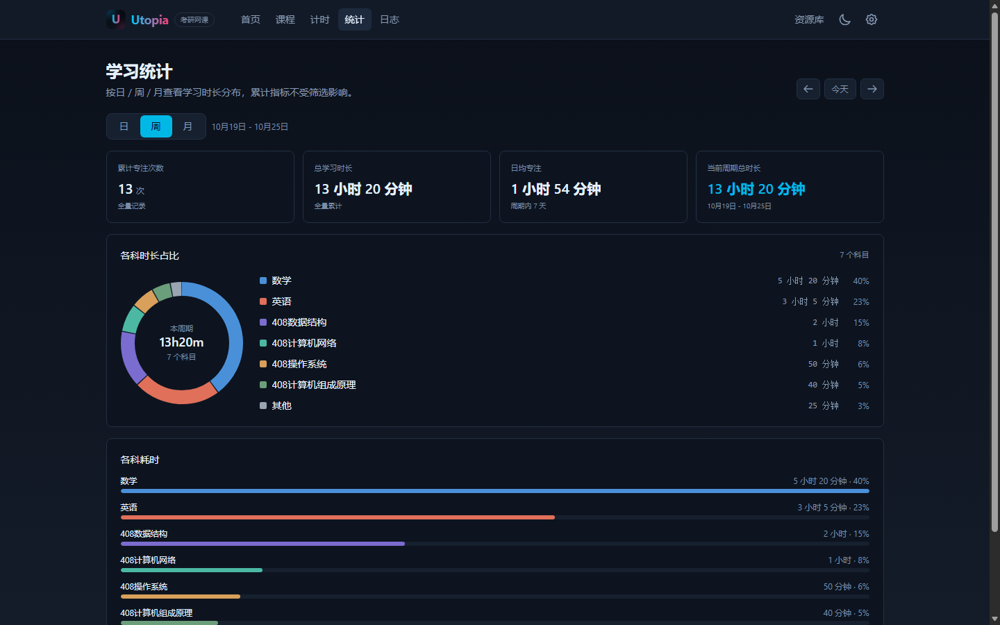
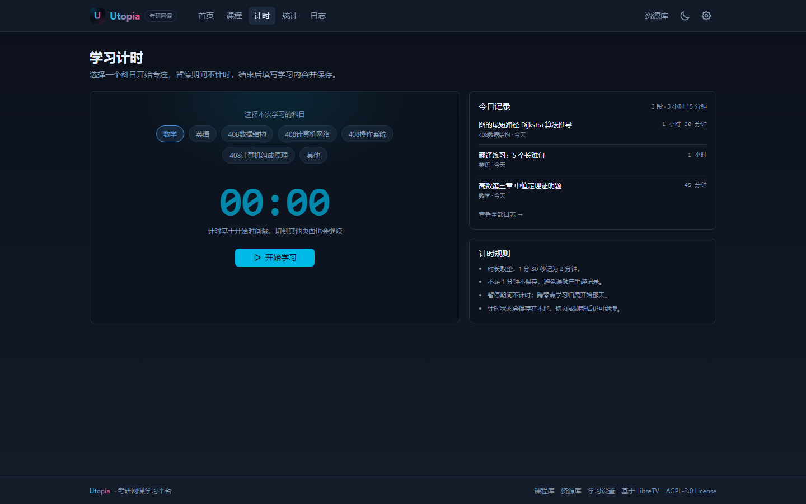

# Utopia · Web 网课平台

> Utopia 的 Web 端（Next.js）：按科目看网课，自动记录每一分钟学习时长。
> 同仓库另有移动端（`../app`）与分发服务（`../backend`），统一入口见根目录 [README](../README.md)。

基于 [LibreTV](https://github.com/LibreSpark/LibreTV) 二次开发的考研网课平台：**按科目看网课，自动记录每一分钟学习时长**。界面沿用 LibreTV 的深蓝黑 + 霓虹蓝赛博风格，新增倒计时、学习计时、统计图表、学习日志与课程库。

> 数据全部保存在浏览器本地（localStorage），无账号、无云同步；可在「学习设置」导出 JSON 备份。
> 课程视频与资源库内容来自你自行配置的第三方地址，请确保拥有相应学习权限。

## 界面预览

> 截图使用演示数据，仅用于展示布局与配色；深色主题与 LibreTV 保持一致。

| 学习台 | 课程库 |
| --- | --- |
|  |  |

| 统计（周） | 学习计时 |
| --- | --- |
|  |  |

---

## 功能

### 学习闭环

- **考试倒计时**：目标日期可配置，默认当年 12 月 20 日；过期自动切换「已考完」文案。
- **网课播放即计时**：课程章节播放时按真实播放进度累计学习时长，暂停、快进不计；满 1 分钟可结束并填写学习内容，离开页面自动保存。
- **自由计时**：选科目开始 / 暂停 / 继续 / 结束，状态跨页保持；刷新后按心跳恢复，离线时段不计入。
- **今日汇总**：今日总时长、各科耗时、每日目标进度。
- **统计**：日 / 周 / 月（自然周、自然月）切换，累计次数、总时长、日均时长、周期时长、各科占比环形图与明细。
- **学习日志**：按日期倒序分页（20 条/页），日期 + 科目筛选，编辑、删除（可撤销）、手动补录。
- **课程库**：按 7 个考研科目组织课程；新建 / 编辑课程，章节支持 m3u8 / mp4 直链，记录章节学习进度。
- **资源库**：保留 LibreTV 的多源聚合搜索，用来检索第三方点播源中的网课视频。
- **备份恢复**：导出 / 导入「Utopia」JSON（合并按记录 ID 去重，或覆盖导入），同时备份课程库。

### 科目与配色（开发文档第九节）

数学 · 英语 · 408数据结构 · 408计算机网络 · 408操作系统 · 408计算机组成原理 · 其他。
科目固定配色贯穿课程卡片、统计饼图与日志徽标。

### 计时口径

| 规则 | 说明 |
| --- | --- |
| 取整 | `ceil(秒 / 60)`，1 分 30 秒记为 2 分钟 |
| 最短时长 | 不足 1 分钟不保存 |
| 暂停 | 暂停期间不计时，网课暂停同样不计 |
| 跨零点 | 记录归属计时开始那天 |
| 日均 | 周期总时长 ÷ 周期内已过天数 |
| 累计 | 全量记录，不受筛选影响 |

---

## 技术栈

- Next.js 15（App Router）+ React 19 + TypeScript + Tailwind CSS
- 播放器：ArtPlayer + hls.js（沿用 LibreTV 播放内核，含广告过滤、跨源换源、下载等能力）
- 状态：学习数据用 `useSyncExternalStore` + localStorage；LibreTV 原有配置仍用 Zustand / IndexedDB
- 图表：纯 SVG 环形图，无额外图表依赖

## 快速开始

```bash
# 1. 安装依赖（若 pnpm 可用也可用 pnpm）
npm install

# 2. 配置访问密码
cp .env.example .env
# 编辑 .env，至少设置 PASSWORD

# 3. 开发
npm run dev        # http://localhost:8080

# 4. 生产
npm run build
npm start          # 默认 8080
```

Windows PowerShell 示例：

```powershell
$env:PASSWORD = "your-password"; npm run build; npm start
```

### Windows 一键启动

双击 `start-utopia-web.bat` 即可：自动安装依赖（首次）、构建（首次或检测到源码更新时）并启动服务，随后打开 <http://localhost:8080>。

- 访问密码保存在 `.env`；若文件不存在，脚本会生成默认密码 `utopia2026`。
- 修改代码后建议双击 `start-utopia-web-dev.bat`，保存即热更新；正式启动脚本检测到源码比构建新时也会自动重新构建（多等约 1 分钟）。
- 服务在单独的「Utopia Web Server」窗口运行，关闭该窗口即停止服务。

### Docker

```bash
echo "PASSWORD=your-password" > .env
docker compose up -d --build
```

镜像在本仓库构建（`utopia-web:latest`），不依赖上游 LibreTV 镜像。环境变量与 LibreTV 兼容（`PASSWORD`、`PROXY_SECRET`、`DEFAULT_SOURCES`、`DEFAULT_SUBSCRIPTIONS` 等），详见 [LibreTV 配置文档](https://libretv.is-an.org/wiki/Configuration.html)。

---

## 课程从哪里来？

有三条路径，可混用：

1. **课程库 → 添加课程**：为每个章节填入可直链播放的 m3u8 / mp4 地址。项目内置 8 门示例课程，章节使用公开测试流（mux / Apple），仅用于演示「播放即计时」；请替换为你自己的网课直链。
2. **资源库**：先在「学习设置 → 资源数据源」添加 Apple CMS 点播源，回到资源库搜索网课关键词，播放时同样自动计时。
3. **手动补录 / 自由计时**：线下刷题、背书时用，记录同样进入统计与日志。

> 直链需要允许浏览器直接访问（HLS 需 CORS）。部分网课平台的视频带鉴权或防盗链，无法直接播放，请使用自己拥有权限的地址。

---

## 目录结构（新增部分）

```
src/lib/study/
  types.ts        # 数据模型、科目与固定配色、备份格式
  date.ts         # 本地日期工具（跨零点、自然周/月）
  stats.ts        # 日/周/月口径、聚合、连续打卡、课程进度
  store.ts        # localStorage 数据层：记录 / 配置 / 课程库 / 计时会话 / 备份
  seeds.ts        # 内置示例课程
  format.ts       # 时长与日期展示
src/components/study/
  page-shell.tsx  # 页面骨架（顶部导航 + 移动端底部导航）
  countdown-card.tsx
  timer-bar.tsx   # 全局计时迷你条
  save-dialog.tsx # 结束学习保存弹窗
  record-dialog.tsx # 补录 / 编辑记录
  course-card.tsx / course-dialog.tsx
  donut.tsx / subject-badge.tsx
src/app/
  page.tsx        # 学习台首页
  courses/        # 课程库与课程详情
  timer/          # 学习计时
  stats/          # 统计
  logs/           # 学习日志
  settings/       # 学习设置（目标、备份、清空、数据源）
  resources/      # 资源库（LibreTV 聚合搜索）
  watch/          # 播放页（新增网课计时条与自动保存）
```

## 数据与备份

- 学习记录：`localStorage['utopia:records:v1']`
- 配置：`localStorage['utopia:config:v1']`（`examTargetDate`、`dailyTargetMin`）
- 课程库：`localStorage['utopia:courses:v1']`
- 计时会话：`localStorage['utopia:timer:v1']`（每 10s 心跳）

> 改名前使用 `yst:*` 键名的旧数据会在首次读取时自动迁移，升级不会丢失记录。

导出 JSON 与开发文档第七节一致（`app` / `formatVersion` / `config` / `records`），并扩展了可选的 `courses`、`courseId`、`lessonId` 字段；`app` 字段为 `Utopia`，同时兼容导入旧的 `研时记` 备份。

## 开发校验

```bash
npm run typecheck
npm run lint
npm run build
```

## 与 LibreTV 的关系

本项目保留 LibreTV 的聚合搜索、点播源管理、播放器、代理与安全策略等能力，并沿用其视觉语言；新增的学习台、课程库、计时、统计、日志与备份模块为本项目原创。LibreTV 原页面（直播、豆瓣推荐等）不再出现在主导航中，但代码仍保留，可按需接回。

## License

AGPL-3.0-or-later，与上游 LibreTV 一致。
